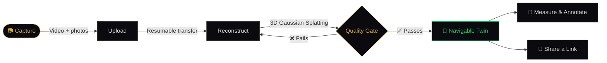

<div align="center">

<!-- ANIMATED HEADER -->


<!-- BADGES ROW -->
<p align="center">
  
  
  
  
  
</p>

<p align="center">
  
  
  
  
  
</p>

<p align="center">
  
  
</p>

---

<!-- ANIMATED TYPING -->

[](https://git.io/typing-svg)

</div>

---

## 📌 Overview

**Digital Twin DT** turns a short video and a few sharp photos into a navigable 3D digital twin of a real space, from a single room to a whole building. This repository is its **open commercial and technical showcase**: what the product does, how it is priced, what it is built with, and how it compares to the market.

> _Engineering first. Little AI. Dark-first UI with gold-accented precision._

> ⚠️ **This is not the product.** The product code is closed source. Everything here, the site, its local API and the content, is commercial information that you are free to read, run and copy under the MIT license.

```
 ┌─────────────────────────────────────────────────────────────┐
 │                  THIS SHOWCASE (runs locally)               │
 │                                                             │
 │   ┌───────────────┐   GET /api/*    ┌───────────────┐       │
 │   │   Web (React) │ ──────────────→ │  Local API    │       │
 │   │ Vite · R3F    │ ←────────────── │  Express · TS │       │
 │   └───────┬───────┘     JSON        └───────┬───────┘       │
 │           │  falls back to bundled content  │               │
 │           └───────────────┬─────────────────┘               │
 │                           ▼                                  │
 │              ┌───────────────────────┐                       │
 │              │   @dtdt/content (TS)  │                       │
 │              │ plans · features · FAQ│                       │
 │              └───────────────────────┘                       │
 └─────────────────────────────────────────────────────────────┘
```

---

## ⚙️ What the Product Does



| # | Phase | Description |
|---|-------|-------------|
| 1️⃣ | **Capture** | A few sharp photos for detail plus a short video for coverage. Any camera works |
| 2️⃣ | **Upload** | Resumable, direct-to-storage transfers that survive a bad connection |
| 3️⃣ | **Reconstruct** | A native C++ / Python pipeline estimates camera poses and builds a 3D Gaussian Splatting model |
| 4️⃣ | **Verify** | A quality gate checks the result before delivery. Generative inpainting is capped at 4 % of a scene |
| 5️⃣ | **Explore & share** | Walk the twin in the browser, measure, annotate and send a link |

**Design principles:** engineering first, little AI, and pricing you can read in one line: **one space = one twin**. No payment, no twin.

---

## 💲 Plans

> USD per month, list prices as of **Nov 2026**. A whole building is **one twin**: its photo and video allowance is shared across floors or zones.

| Plan | Price | Spaces | Allowance per twin | Typical use |
|------|------:|-------:|--------------------|-------------|
| Free | $0 | – | demo twins only | Explore the viewer |
| Starter | **$6** | 3 | 50 photos + 1 min video | Apartments, rooms, objects |
| Plus | **$24** | 10 | 50 photos + 1 min video | Independent pros |
| ⭐ **Pro** | **$55** | 10 | 400 photos + 5 min video | Warehouses, shops, work sites |
| Business | **$149** | 8 | 850 photos + 10 min video | Whole buildings |
| Scale | **$249** | 20 | 850 photos + 10 min video | Teams and portfolios |
| Max | **$339** | 30 | 850 photos + 10 min video | High volume |
| Enterprise | custom | custom | 3,000 photos + 40 min video | Custom limits and support |

Optional add-ons priced separately: **BIM Compare**, **advanced reports**, **exports**. The product website is always the source of truth for prices.

### 📊 Where the market is

| Competitor | Published price | Our answer |
|------------|-----------------|------------|
| KIRI Engine Pro | $79.99 / year (≈ $6.66 / mo) | Starter at $6 |
| Polycam Business | $34 / mo | Plus at $24 |
| Matterport Professional | $58 / mo (annual), camera required | Pro at $55, any camera |
| Matterport Business | $296 / mo (annual) | Business $149 · Scale $249 |
| DroneDeploy Flight & Analysis | $4,188 / year (≈ $349 / mo) | Max at $339 |
| SkyeBrowse | $24.99 – $199 per model | From $2 per twin |

> Plans differ in scope, so read this as orientation, not a like-for-like benchmark. Matterport figures come from a competitor's comparison page: **verify them at matterport.com**. Every figure is linked to its source inside the site.

---

## 🛠️ Technology

<table>
  <thead>
    <tr>
      <th>Layer</th>
      <th>Technology</th>
      <th>Purpose</th>
    </tr>
  </thead>
  <tbody>
    <tr>
      <td>🖥️ <strong>Interface</strong></td>
      <td>React 18 + Vite</td>
      <td>Fast, componentized UI</td>
    </tr>
    <tr>
      <td>🔤 <strong>Language</strong></td>
      <td>TypeScript (strict)</td>
      <td>Type-safe, scalable codebase</td>
    </tr>
    <tr>
      <td>🎨 <strong>Styling</strong></td>
      <td>Tailwind CSS 3</td>
      <td>Utility-first, responsive from 310 px to 2100 px</td>
    </tr>
    <tr>
      <td>🧊 <strong>3D</strong></td>
      <td>Three.js · React Three Fiber</td>
      <td>In-browser 3D viewer</td>
    </tr>
    <tr>
      <td>⚡ <strong>State</strong></td>
      <td>Zustand</td>
      <td>Small, predictable global state</td>
    </tr>
    <tr>
      <td>🔧 <strong>Services</strong></td>
      <td>Node.js + TypeScript</td>
      <td>Strictly typed, validated APIs</td>
    </tr>
    <tr>
      <td>🗄️ <strong>Data</strong></td>
      <td>MongoDB · Redis</td>
      <td>Operational data, queues and caching</td>
    </tr>
    <tr>
      <td>🧠 <strong>Reconstruction</strong></td>
      <td>C++17 · Python · 3D Gaussian Splatting · GPU</td>
      <td>Performance-critical vision pipeline</td>
    </tr>
    <tr>
      <td>💳 <strong>Payments</strong></td>
      <td>Wompi</td>
      <td>Local payment methods in Colombia and LatAm</td>
    </tr>
    <tr>
      <td>🐳 <strong>DevOps</strong></td>
      <td>Docker Alpine · AWS · GitHub Actions</td>
      <td>Reproducible builds and automated checks</td>
    </tr>
  </tbody>
</table>

> This showcase itself uses the interface, language, styling, 3D, state and DevOps rows. The remaining rows describe the closed product.

---

## ✅ Honest Status

| Item | Status |
|------|--------|
| Fidelity target ≈ 97 % | 🎯 **Target.** Still being validated with real captures. Not a published benchmark |
| Processing time 2–3 h (ideally < 2 h) | 🎯 **Target.** Depends on capture size |
| Measurements and annotations, plan and BIM compare | 🟡 In progress |
| Structural element tracking, live option | 🔵 Roadmap |
| Competitor prices | 📎 Public list prices found in Nov 2026. Verify at the source |

---

## 🐳 Docker Infrastructure

The showcase runs in two small containers: **identical behavior** on any machine.

```yaml
# docker-compose.yml: local only
services:
  api:
    build: { context: ., dockerfile: apps/api/Dockerfile }
    environment:
      PORT: "4100"
      CORS_ORIGINS: http://localhost:8080,http://localhost:5173
    ports: ["4100:4100"]
  web:
    build: { context: ., dockerfile: apps/web/Dockerfile }
    depends_on: [api]
    ports: ["8080:80"]
```

### API: Node 22 Alpine, non-root, with health check

```dockerfile
FROM node:22-alpine
WORKDIR /app
ENV NODE_ENV=production
COPY package.json package-lock.json tsconfig.base.json ./
COPY packages/content packages/content
COPY apps/api apps/api
RUN npm ci --workspace @dtdt/api --workspace @dtdt/content --include-workspace-root=false --include=dev
USER node
EXPOSE 4100
HEALTHCHECK --interval=15s --timeout=3s CMD wget -qO- http://127.0.0.1:4100/api/health || exit 1
CMD ["npx", "tsx", "apps/api/src/server.ts"]
```

### Web: multi-stage build served by nginx

```dockerfile
# ── Stage 1: Build ──────────────────────────────────
FROM node:22-alpine AS build
WORKDIR /app
COPY package.json package-lock.json tsconfig.base.json ./
COPY packages/content packages/content
COPY apps/web apps/web
RUN npm ci --workspace @dtdt/web --workspace @dtdt/content --include-workspace-root=false
RUN npm run build -w @dtdt/web

# ── Stage 2: Serve ──────────────────────────────────
FROM nginx:1.27-alpine
COPY apps/web/nginx.conf /etc/nginx/conf.d/default.conf
COPY --from=build /app/apps/web/dist /usr/share/nginx/html
EXPOSE 80
```

```nginx
# apps/web/nginx.conf
server {
  listen 80;
  root /usr/share/nginx/html;
  index index.html;
  add_header X-Content-Type-Options nosniff;
  add_header Referrer-Policy strict-origin-when-cross-origin;
  location /api/ { proxy_pass http://api:4100; }
  location /assets/ { expires 1y; add_header Cache-Control "public, immutable"; }
  location / { try_files $uri /index.html; }
}
```

---

## 🚀 Getting Started

### Prerequisites

```bash
node   >= 20.x   # 22 recommended
npm    >= 10.x
docker >= 24.x   # optional
```

### Local Development (Native)

```bash
# 1. Clone the repository
git clone https://github.com/NietoDeveloper/Digital-Twin-DT.git
cd Digital-Twin-DT

# 2. Install and run web + API together
npm install
npm run dev

# → Web: http://localhost:5173
# → API: http://localhost:4100/api/health
```

If the API is not running, the site falls back to the bundled content and says so in the hero.

### Local Development (Docker)

```bash
npm run docker:up
# → Web: http://localhost:8080   API: http://localhost:4100

npm run docker:down
```

### Add your photos and videos

Drop files into [`apps/web/public/media`](apps/web/public/media/README.md) (`apartment.jpg`, `apartment.mp4`, …). Missing files show a blank "coming soon" frame.

### Quality checks

```bash
npm run typecheck      # strict TypeScript across the monorepo
npm test               # API, content and utility tests
npm run check:public   # fails if a secret or private reference sneaks in
npm run verify         # all of the above + production build
```

---

## 📁 Project Structure

```
Digital-Twin-DT/
├── 📁 apps/
│   ├── 📁 web/                  # Vite + React + TS + Tailwind + R3F showcase
│   │   ├── 📁 src/components/   # Hero, sections, examples, 3D point cloud
│   │   ├── 📁 public/media/     # Your photos and videos go here
│   │   ├── Dockerfile
│   │   └── nginx.conf
│   └── 📁 api/                  # Express + TS API serving the content (local)
│       ├── 📁 src/
│       ├── 📁 tests/
│       └── Dockerfile
├── 📁 packages/
│   └── 📁 content/              # Typed content shared by web and API
├── 📁 scripts/                  # check-public guard
├── 📁 docs/                     # GitHub "About" settings
├── docker-compose.yml
├── CONTRIBUTING.md · SECURITY.md · LICENSE
└── package.json                 # npm workspaces
```

---

## 🎨 Design System

> Dark-first · Gold-accented precision · Shared with the product's identity

| Token | Value | Usage |
|-------|-------|-------|
| `brand` / `gold` | `#D4AF37` | Primary accents, CTAs, highlights |
| `gainsboro` | `#DCDCDC` | Secondary text, subtle elements |
| `bg-base` | `#0A0A0F` | Main background |
| `bg-surface` | `#12121A` | Cards and panels |
| `bg-elevated` | `#18181F` | Elevated components |
| `bg-line` | `#1E1E2E` | Borders and dividers |
| `cyan` | `#00D4FF` | Data and 3D accents |

Typography: **Inter** for text, **JetBrains Mono** for labels and code.

---

## 🔒 Not Deployed, On Purpose

```
┌─────────────────────────────────────────────────────────────┐
│                      PUBLIC PERIMETER                       │
│                                                             │
│   ✅ Marketing copy, prices, comparisons                    │
│   ✅ A small React site and a tiny local API                │
│   ✅ Docker files for this showcase only                    │
│                                                             │
│   ⛔ No product source code                                 │
│   ⛔ No infrastructure layout                               │
│   ⛔ No secrets or credentials                              │
└─────────────────────────────────────────────────────────────┘
```

| Feature | Details |
|---------|---------|
| 🏠 **Local only** | Meant to be cloned and run on your machine, not hosted |
| 🛡️ **Guarded** | `npm run check:public` runs in CI and blocks keys, connection strings and private references |
| 📜 **Copy freely** | It is all commercial information, so remixing it is fine |

---

## 🤝 Contributing

Corrections to facts, prices or links are welcome.

```bash
# 1. Fork & clone
# 2. Create a branch
git checkout -b fix/your-change

# 3. Verify
npm install && npm run verify

# 4. Commit with a conventional message and open a Pull Request
git commit -m "fix: update KIRI Engine price"
git push origin fix/your-change
```

> Content lives in `packages/content/src/data.ts`. Please cite a source for any competitor figure. All PRs run the CI pipeline automatically via GitHub Actions. See [CONTRIBUTING](CONTRIBUTING.md) and [SECURITY](SECURITY.md).

---

## 📄 License

[MIT](LICENSE) for this repository. The Digital Twin DT product, name, logo and brand belong to Software DT.

---

<div align="center">


**Sharp twins. Honest numbers. Built with precision.**

[](https://react.dev)
[](https://docker.com)
[](https://github.com/NietoDeveloper)

Built by **[Manuel Nieto](https://github.com/NietoDeveloper)** · [softwaredt.com](https://softwaredt.com) · Software DT

_© 2026 Software DT. Showcase code under the MIT license._

</div>
